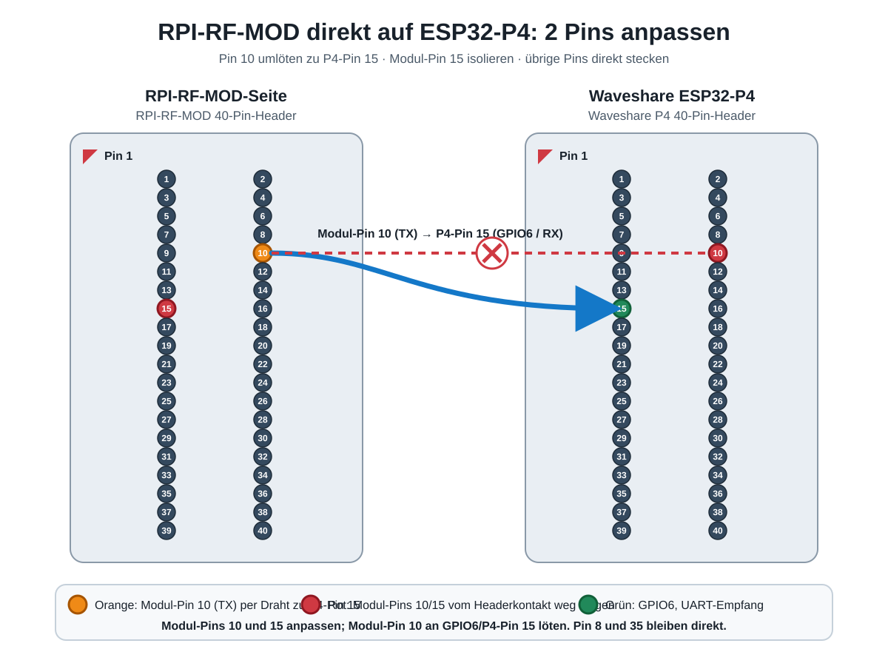

# RFNETHM auf Waveshare ESP32-P4-Module-DEV-KIT

Der P4-Port nutzt den RPI-RF-MOD über den 40-Pin-Header und das onboard IP101-Ethernet am RJ45. Das bestehende S3-Ziel bleibt unverändert.

## Firmware bauen und flashen (Windows)

Benötigt wird ESP-IDF 5.5.5 mit installierten Tools. Im ESP-IDF-PowerShell-Terminal im Repository:

```powershell
cd firmware
.\build_p4.ps1 build
.\build_p4.ps1 flash -Port COM7
.\build_p4.ps1 monitor -Port COM7
```

`COM7` ist der beim Portieren erkannte USB-Seriell-Port und kann sich nach erneutem Anstecken ändern. Das Skript setzt als Ziel ESP32-P4 und verwendet die Firmware-Defaults für den erkannten Chip Revision 1.3. Ethernet bezieht seine Adresse per DHCP; danach sind WebUI und RFNetHM-Dienste unter dieser IP erreichbar.

## Header-Belegung

| RPI-RF-MOD 40-Pin | Waveshare P4 | Funktion |
| --- | --- | --- |
| 2 oder 4 | 2 oder 4 | 5 V Versorgung |
| 6 | 6 | GND |
| 8 | GPIO37 | P4 UART TX → Modul RX |
| 10 | per Drahtbrücke zu P4-Pin 15 | Modul TX → P4 UART RX |
| 15 | GPIO6 | UART-RX-Eingang des P4; Modul-Pin 15 bleibt isoliert |
| 35 | GPIO53 | Reset, aktiv HIGH |
| 36 | GPIO46 | Modul-LED rot (Ausgang, 1 = an) |
| 38 | GPIO27 | Modul-LED grün (Ausgang, 1 = an) |
| 40 | GPIO45 | Modul-LED blau (Ausgang, 1 = an); am DEV-KIT zugleich SD-Karten-Power-Enable (Q1), ohne SD-Karte folgenlos |
| 32 | GPIO54 | Modul-Taster (BTN) — nicht angesteuert; am DEV-KIT ist GPIO54 der ESP32-C6-Enable |

Die Firmware konfiguriert UART1 mit 115200 Baud. Die Belegung ist für den Header des DEV-KIT bestimmt.

## RGB-LED des RPI-RF-MOD

Die LED auf dem Funkmodul hängt an den Header-Pins 36/38/40 und wird vom
Host getrieben (wie bei piVCCU/RaspberryMatic über `rpi_rf_mod_led.ko`,
Pegel 1 = an). Seit v0.17.0 bedient RFNETHM sie:

| Zustand | LED | Quelle |
| --- | --- | --- |
| Boot, kein HB-RF-ETH-Client | aus | lokal |
| Client verbunden, noch kein StartConn | gelb (rot+grün) | lokal |
| Client verbunden und StartConn (Frames fließen) | grün | lokal |
| Keepalive-Timeout, kein Client mehr | rot | lokal |
| CCU schreibt `/sys/class/leds/rpi_rf_mod:*` | exakt wie bestellt | HB-RF-ETH Typ 3 |

Hat die CCU einmal einen Zustand gesetzt, überschreiben lokale Ereignisse
ihn nicht mehr (außer „alle Clients weg“). Die lokalen Farben sind deshalb
nur bis zum ersten CCU-Kommando zu sehen.

`hb_rf_eth.ko` schickt den Zustand nur bei Änderungen, auch nach einem
Reconnect nicht erneut. Seit v0.19.0 merkt sich RFNETHM deshalb den letzten
CCU-Zustand und setzt ihn selbst wieder, sobald der Kernel die Session
wieder aufnimmt (V2-Resume) — nach einem Keepalive-Timeout ebenso wie nach
einem eigenen Software-Neustart (`/api/reboot`, OTA-Update, Panic,
Watchdog). Der Zustand liegt dafür im RTC-Speicher, nicht im Flash.
Verloren geht er nach einem Kaltstart (Strom weg, Reset-Taste), beim Update
von einer Version vor 0.19.0 und wenn ein Update die Aufteilung des
RTC-Speichers ändert; dann gilt bis zum nächsten CCU-Kommando wieder die
lokale Anzeige. Eine neue Kernel-Session (etwa nach dem Neuladen von
`hb_rf_eth.ko`) verwirft den gemerkten Zustand. Nach einem Test-Hold ohne
neues CCU-Kommando kehrt die LED zum letzten bekannten CCU-Zustand zurück.

### Was die CCU anzeigt

Die Farben bestimmt `hss_led` in OpenCCU, mit derselben Logik wie bei der
CCU3:

| CCU-Zustand | LED |
| --- | --- |
| Normalbetrieb, Internet erreichbar | blau |
| Servicemeldung offen | gelb und blau im Wechsel (langsam) |
| Alarmmeldung offen | rot und blau im Wechsel (langsam) |
| IP-Adresse, aber kein Internet | blau, schnell blinkend |
| Netzwerk-Link, aber noch keine IP-Adresse | blau, langsam blinkend |
| kein Netzwerk-Link | gelb, schnell blinkend |
| ein CCU-Dienst läuft nicht | rot |
| „LED-Nutzung (Funkmodul)“ in der WebUI aus (`/etc/config/disableLED`) | aus |

Welche Meldungen zählen, steht in `/etc/config/hss_led_info.conf`
(`IgnoreServiceMessages`, `IgnoreAlarmMessages`).

### Einschränkung: OpenCCU bis 3.89.11 auf Home Assistant OS

`hss_led` 2.3, enthalten bis einschließlich OpenCCU 3.89.11.20260919,
schaltet Dauerlicht über den Kernel-Trigger `default-on` und Blinken über
`timer`. Der Kernel von Home Assistant OS enthält beide nicht
(`CONFIG_LEDS_TRIGGER_DEFAULT_ON` und `CONFIG_LEDS_TRIGGER_TIMER` nicht
gesetzt). Der Trigger-Wechsel schlägt dann fehl, `hss_led` liest „none“,
hält die LED für aus und setzt bei jedem Durchlauf alle drei Farben auf
aus. RFNETHM bekommt deshalb nur „aus“-Kommandos (Bündel von 4–8
Typ-3-Paketen alle paar Sekunden, `led.src` = `host`), und die LED bleibt
auch bei offenen Alarm- und Servicemeldungen dunkel. Das Original-HB-RF-ETH
ist genauso betroffen; an RFNETHM liegt es nicht.

Prüfen lässt sich das auf dem CCU-Host mit
`cat /sys/class/leds/rpi_rf_mod:red/trigger`: Fehlt `timer` in der Liste,
tritt das Problem auf.

Abhilfe bringt der neue `hss_led` aus OpenCCU-Base
([PR #59](https://github.com/OpenCCU/OpenCCU-Base/pull/59), seit 2026-09-27
im Hauptzweig von OpenCCU). Er setzt die Helligkeit direkt und blinkt im
Userspace, wenn der Kernel `timer` nicht anbietet. Er ist im ersten
OpenCCU-Release nach 3.89.11.20260919 zu erwarten; ab dann sollte die LED
die CCU-Zustände ohne Änderung an RFNETHM zeigen (mit RFNETHM noch nicht
getestet).

### Hardware-Test und Status

Hardware-Test: `POST /api/led` mit `{"r":true,"g":false,"b":false,"hold_ms":5000}`
oder ein Klick auf einen der drei Punkte in der HB-RF-ETH-Kachel der WebUI.
Die Firmware hält die Testfarbe `hold_ms` lang (Default 5 s, max 30 s),
puffert solange die CCU-Kommandos und wendet danach das letzte an (oder den
letzten bekannten CCU-Zustand, wenn währenddessen keins kam).
`/api/status` zeigt unter `led` Zustand, Quelle (`boot`/`local`/`host`/`api`),
`hold`, die Zahl der CCU-Kommandos (`host_cmds`), ob ein CCU-Zustand bekannt
ist (`host_known`) und ob er von vor einem Neustart stammt (`restored`).

## Stromausfall und WatchDog-Alarm in OpenCCU

OpenCCU prüft mit monit in jedem Durchlauf, ob `hb_rf_eth.ko` verbunden ist
(Regel `hb_rf_eth-Check` in `/etc/monitrc`, liest
`/sys/class/hb-rf-eth/hb-rf-eth/is_connected`). Schon eine einzige
fehlgeschlagene Prüfung erzeugt die Alarmmeldung
„WatchDog: hb-rf-eth-connection“. Nach einem Stromausfall von RFNETHM ist das
erwartet und beim Original-HB-RF-ETH genauso, denn die Verbindung war
tatsächlich weg. Den Alarm in der WebUI unter „Alarmmeldungen“ bestätigen.

Nach dem Einschalten ist RFNETHM nach rund 4 s wieder im Netz (Ethernet-Link
und DHCP), danach nimmt `hb_rf_eth.ko` die Session von selbst wieder auf. Die
Modul-LED zeigt dabei kurz die lokale Farbe (grün), bis das erste
CCU-Kommando kommt; einen gemerkten CCU-Zustand gibt es nach einem Kaltstart
nicht. Ein OTA-Update oder `/api/reboot` unterbricht die Verbindung nur
wenige Sekunden (der Kernel meldet sie nach 5 s ohne Keepalive als
getrennt); der Alarm kommt dann nur, wenn eine monit-Prüfung genau in diese
Lücke fällt.

## Direkt aufstecken: zwei Pins anpassen, eine Drahtbrücke löten

Ein Zwischenadapter ist nicht nötig. Am **RPI-RF-MOD** nur diese zwei Pins
vom Kontakt zum P4-Header weg umbiegen:

1. **Modul-Pin 10 (UART-TX):** vom P4-Pin 10 fernhalten und mit einer kurzen
   isolierten Drahtbrücke an **P4-Pin 15 (GPIO6 / UART-RX)** anlöten.
2. **Modul-Pin 15:** ebenfalls so umbiegen, dass er **P4-Pin 15** nicht
   berührt. Dadurch bleibt GPIO6 ausschließlich mit Modul-Pin 10 verbunden.

Danach kann das RPI-RF-MOD direkt auf den 40-Pin-Header des P4-Boards gesteckt
werden. **Alle übrigen Pins bleiben unverändert und werden direkt aufgesteckt.**
P4-Pin 8 / GPIO37 bleibt UART-TX zum Modul; Reset bleibt P4-Pin 35 / GPIO53.
Beim Umbiegen und Löten Board und Funkmodul vollständig von USB und Netzteil
trennen.


